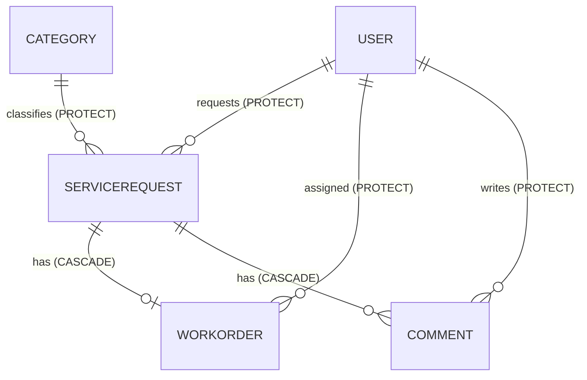

# Lab 3 ERD: Service Request Domain

| Parent | Relationship | Child | Deletion rule |
|---|---|---|---|
| User | one to many | ServiceRequest (requester) | PROTECT |
| Category | one to many | ServiceRequest | PROTECT |
| ServiceRequest | one to zero or one | WorkOrder | CASCADE |
| User | one to many | WorkOrder (technician) | PROTECT |
| ServiceRequest | one to many | Comment | CASCADE |
| User | one to many | Comment (author) | PROTECT |

